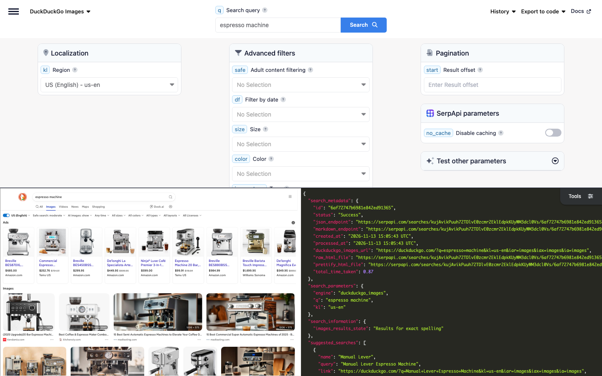

# DuckDuckGo Images Scraper

Scrape DuckDuckGo Images search results with SerpApi's DuckDuckGo Images API. Search images by keyword in 63 regions or with no region, filter them by date, size, color, type, layout, and license, or hide AI-generated images. Get up to 100 images per page, each with its title, the page and website it's on, a thumbnail, the original image with its width, height, and format, and the date DuckDuckGo found it, plus shopping ads with prices and stores for product searches, and suggested searches.

## How to scrape DuckDuckGo Images search results

Search DuckDuckGo Images with a simple GET request:

```text
https://serpapi.com/search?engine=duckduckgo_images&q=espresso+machine&api_key=SERPAPI_API_KEY
```

- `q` is the search query: anything you'd use in a regular DuckDuckGo Images search, including operators such as `site:`.
- `api_key` is your SerpApi API key. Replace `SERPAPI_API_KEY` with it.
- `kl` sets the region, e.g., `uk-en` for the United Kingdom or `fr-fr` for France. Defaults to `us-en`.
- `safe` sets the adult content filter: `1` for strict, `-1` for moderate (default), or `-2` for off.
- `df`, `size`, `color`, `image_type`, `layout`, and `license` filter the images like the filters above the results on DuckDuckGo Images, e.g., `df=w` for the past week or `layout=Wide`.
- `hide_ai_images` set to `true` hides AI-generated images, like DuckDuckGo's Hide AI images setting.
- `start` gets the next pages of results. DuckDuckGo Images returns up to 100 images per page, so the second page starts at `100`.

The last page has no `serpapi_pagination`, e.g., `start=600` for espresso machine. A `start` past the last page doesn't return an error, but a few images repeated from earlier pages, so stop when `serpapi_pagination` is missing.

[Register at SerpApi](https://serpapi.com?utm_source=github_duckduckgo_images_scraper) to get your API key, and keep it private.

### Playground

Try the request live in the [SerpApi Playground](https://serpapi.com/playground?engine=duckduckgo_images&q=espresso+machine&utm_source=github_duckduckgo_images_scraper).

[](https://serpapi.com/playground?engine=duckduckgo_images&q=espresso+machine&utm_source=github_duckduckgo_images_scraper)

## Code examples

The code examples read your API key from the `SERPAPI_API_KEY` environment variable:

```bash
export SERPAPI_API_KEY="SERPAPI_API_KEY"
```

Each example searches DuckDuckGo Images for “espresso machine” and prints the title, source, and original image link of each image.

### curl integration

Send the request with curl, which prints the full JSON response:

```bash
curl --get https://serpapi.com/search \
 --data-urlencode engine="duckduckgo_images" \
 --data-urlencode q="espresso machine" \
 --data-urlencode api_key="$SERPAPI_API_KEY"
```

### JavaScript integration

Install the [SerpApi JavaScript library](https://github.com/serpapi/serpapi-javascript) and set your project to use ES modules:

```bash
npm install serpapi
npm pkg set type=module
```

Create an `index.js` file:

```javascript
import { getJson } from "serpapi";

const results = await getJson({
  engine: "duckduckgo_images",
  api_key: process.env.SERPAPI_API_KEY,
  q: "espresso machine",
});

for (const image of results.images_results ?? []) {
  console.log(image.title, image.source, image.original);
}
```

Run it with `node index.js`.

### Python integration

Install the [SerpApi Python library](https://github.com/serpapi/serpapi-python):

```bash
pip install serpapi
```

Create a `main.py` file:

```python
import os
import serpapi

client = serpapi.Client(api_key=os.getenv("SERPAPI_API_KEY"))
results = client.search({
    "engine": "duckduckgo_images",
    "q": "espresso machine",
})

for image in results.get("images_results", []):
    print(image["title"], image["source"], image["original"])
```

Run it with `python main.py`.

### Ruby integration

Install the [SerpApi Ruby library](https://github.com/serpapi/serpapi-ruby):

```bash
gem install serpapi
```

Create a `main.rb` file:

```ruby
require "serpapi"

client = SerpApi::Client.new(engine: "duckduckgo_images", api_key: ENV.fetch("SERPAPI_API_KEY"))
results = client.search(q: "espresso machine")

results.fetch(:images_results, []).each do |image|
  puts "#{image[:title]} #{image[:source]} #{image[:original]}"
end

client.close
```

Run it with `ruby main.rb`.

### PHP integration

Install the [SerpApi PHP library](https://github.com/serpapi/serpapi-php):

```bash
composer require serpapi/serpapi-php
```

Create an `index.php` file:

```php
<?php
require 'vendor/autoload.php';

use SerpApi\Client;

$client = new Client(getenv('SERPAPI_API_KEY'), 'duckduckgo_images');
$results = $client->search([
  'q' => 'espresso machine',
]);

foreach ($results->images_results ?? [] as $image) {
  echo $image->title . ' ' . $image->source . ' ' . $image->original . PHP_EOL;
}
```

Run it with `php index.php`.

### Go integration

Create a Go module and install the [SerpApi Go library](https://github.com/serpapi/serpapi-golang):

```bash
go mod init example.com/ddgimages
go get github.com/serpapi/serpapi-golang
```

Create a `main.go` file:

```go
package main

import (
	"fmt"
	"os"

	"github.com/serpapi/serpapi-golang"
)

func main() {
	setting := serpapi.NewSerpApiClientSetting(os.Getenv("SERPAPI_API_KEY"))
	setting.Engine = "duckduckgo_images"
	client := serpapi.NewClient(setting)

	results, err := client.Search(map[string]string{
		"q": "espresso machine",
	})
	if err != nil {
		panic(err)
	}

	imagesResults, _ := results["images_results"].([]interface{})
	for _, item := range imagesResults {
		image := item.(map[string]interface{})
		fmt.Println(image["title"], image["source"], image["original"])
	}
}
```

Run it with `go run .`.

### Rust integration

Create a Cargo project and add the [SerpApi Rust library](https://github.com/serpapi/serpapi-rust) and Tokio:

```bash
cargo new ddg-images && cd ddg-images
cargo add serpapi tokio --features tokio/full
```

Replace `src/main.rs` with:

```rust
use serpapi::serpapi::Client;
use std::collections::HashMap;
use std::env;

#[tokio::main]
async fn main() -> Result<(), Box<dyn std::error::Error>> {
    let mut default = HashMap::new();
    default.insert("api_key".to_string(), env::var("SERPAPI_API_KEY")?);
    default.insert("engine".to_string(), "duckduckgo_images".to_string());
    let client = Client::new(default)?;

    let mut parameter = HashMap::new();
    parameter.insert("q".to_string(), "espresso machine".to_string());

    let results = client.search(parameter).await?;
    if let Some(images_results) = results["images_results"].as_array() {
        for image in images_results {
            println!(
                "{} {} {}",
                image["title"].as_str().unwrap_or_default(),
                image["source"].as_str().unwrap_or_default(),
                image["original"].as_str().unwrap_or_default()
            );
        }
    }
    Ok(())
}
```

Run it with `cargo run`.

### Other programming languages

Official libraries are also available for [Java](https://github.com/serpapi/serpapi-java), [.NET](https://github.com/serpapi/serpapi-dotnet), [Swift](https://github.com/serpapi/serpapi-swift), and [C++](https://github.com/serpapi/serpapi-cpp). See [SerpApi integrations](https://serpapi.com/integrations?utm_source=github_duckduckgo_images_scraper) for setup guides, or use a simple GET request from any programming language.

### Errors

Failed requests return an HTTP error status and a JSON body with an `error` message. The most common are `401` for an invalid API key, `400` for a missing required parameter such as `q` or an unsupported `kl` region, and `429` when you exceed your hourly throughput limit or run out of searches. See [API status and error codes](https://serpapi.com/api-status-and-error-codes?utm_source=github_duckduckgo_images_scraper) for the full list.

A search without images still returns `200`, with `search_metadata.status` set to `Success` and the error "DuckDuckGo Images hasn't returned any results for this query.", so check for `error` before reading `images_results`. Such a search can still have `shopping_results` and `suggested_searches`.

## Output formats: JSON and Markdown

Choose structured JSON for applications or Markdown for LLMs and AI agents:

- JSON is the default output and is useful when you need individual result fields.
- Add `output=md` to receive Markdown instead, which is more token-efficient.

Markdown is plain text, not JSON: YAML front matter with the search metadata, followed by the search information, tables of the suggested searches and shopping ads, if any, a table of the images with their title linked to their page, source, original image link, width, height, thumbnail, format, and date, and a link to the next page. A search without images has the error instead of the images table. Read the response body as text instead of parsing it.

| Client | Markdown request |
|--------|------------------|
| curl | `--data-urlencode output="md"` |
| Python | `client.search({..., "output": "md"})` |
| PHP | `$client->md([...])` |
| Go | `client.Md(map[string]string{...})` |
| Rust | `client.md(parameter).await?` |

If your SDK doesn't have a Markdown helper yet, send a plain HTTP request with `output=md` and read the body as text. Learn more about [Markdown output](https://serpapi.com/markdown-output?utm_source=github_duckduckgo_images_scraper).

## DuckDuckGo Images API parameters

See the [DuckDuckGo Images API documentation](https://serpapi.com/duckduckgo-images-api?utm_source=github_duckduckgo_images_scraper) for more details.

| Name | Description | Requirement |
|------|-------------|-------------|
| **Search query** | | |
| `q` | The search query: anything you'd use in a regular DuckDuckGo Images search (e.g., `espresso machine`), including operators such as `site:` (e.g., `espresso machine site:seriouseats.com`). Can't exceed 500 characters. | Required |
| **Localization** | | |
| `kl` | The region to search in, as a DuckDuckGo region code (e.g., `us-en` for the United States, `uk-en` for the United Kingdom, `fr-fr` for France, or `wt-wt` for no region). Defaults to `us-en`. See [DuckDuckGo regions](https://serpapi.com/duckduckgo-regions?utm_source=github_duckduckgo_images_scraper) for supported regions. | Optional |
| **Advanced filters** | | |
| `safe` | The adult content filter: `1` for strict, `-1` for moderate (default), or `-2` for off. | Optional |
| `df` | The date filter: `d` for the past day, `w` for the past week, `m` for the past month, or `y` for the past year. Images filtered by `d`, `w`, or `m` have no `date`. | Optional |
| `size` | The size filter: `Small`, `Medium`, `Large`, or `Wallpaper`. | Optional |
| `color` | The color filter: `color` for color only, `Monochrome` for black and white, or one of `Red`, `Orange`, `Yellow`, `Green`, `Blue`, `Purple`, `Pink`, `Brown`, `Black`, `Gray`, `Teal`, and `White`. | Optional |
| `image_type` | The type filter: `photo` for photographs, `clipart`, `gif` for animated GIFs, `transparent`, or `line` for line drawings. | Optional |
| `layout` | The layout filter: `Square`, `Tall`, or `Wide`. | Optional |
| `license` | The license filter, with DuckDuckGo's labels: `Any` for All Creative Commons, `Public` for Public domain, `Share` for Free to share and use, `ShareCommercially` for Free to share and use commercially, `Modify` for Free to modify, share, and use, or `ModifyCommercially` for Free to modify, share, and use commercially. | Optional |
| `hide_ai_images` | Set to `true` to hide AI-generated images, like DuckDuckGo's Hide AI images setting, or `false` (default). DuckDuckGo then returns a different, often smaller set of images, e.g., 52 instead of 100 for `fantasy castle`. | Optional |
| **Pagination** | | |
| `start` | The result offset: the number of images to skip (e.g., `100` for the second page). Defaults to `0`. DuckDuckGo Images returns up to 100 images per page. The next page is in `serpapi_pagination.next`, which is missing on the last page. | Optional |
| **SerpApi parameters** | | |
| `engine` | Set to `duckduckgo_images`. | Required |
| `api_key` | Your private SerpApi API key. | Required |
| `no_cache` | Set to `true` to request fresh results instead of using the one-hour cache. Can't be combined with `async`. | Optional |
| `async` | Set to `true` for later retrieval through the [Searches Archive API](https://serpapi.com/search-archive-api?utm_source=github_duckduckgo_images_scraper). Can't be combined with `no_cache` or used with Ludicrous Speed enabled. | Optional |
| `zero_trace` | Enterprise only. Set to `true` to skip storing search parameters, files, and metadata on SerpApi servers. | Optional |
| `output` | Set to `json` (default), `html` for the raw JSON retrieved from DuckDuckGo, or `md` for Markdown. | Optional |
| `json_restrictor` | Limit the JSON response to the fields you need. See the [JSON Restrictor](https://serpapi.com/json-restrictor?utm_source=github_duckduckgo_images_scraper) documentation. | Optional |

## Available data on DuckDuckGo Images search results (JSON response)

Each item in `images_results` is an image found by DuckDuckGo Images, in the order DuckDuckGo shows them. The response also includes `search_information`, the `suggested_searches` DuckDuckGo shows above the images, `shopping_results` with DuckDuckGo's shopping ads for product searches, and `serpapi_pagination` with the next page. The field guides below describe the possible fields and their types; they aren't literal API responses.

### What you get depends on the search

Some fields appear only for some searches:

| Search | Fields |
|--------|--------|
| A product search, e.g., espresso machine or office chair | `shopping_results` on the first page, with up to 54 ads: up to 36 with `block_position` set to top, and up to 18 set to middle, which mostly repeat the top ones |
| An ad for a discounted product | `old_price` and `extracted_old_price`, e.g., $699.95 for an espresso machine sold for $449.95, and sometimes the price drop in `tag`, e.g., 19 % price drop |
| An ad with a store offer | `special_offer`, e.g., $10 off select items, its short version in `tag`, e.g., $10 off*, and `special_offer_expires_in_days`, e.g., 157 |
| An ad for a product with reviews | `rating` and `reviews`, e.g., 4.5 and 942 for an office chair |
| An ad for a product in a store nearby | `in_store` and `store_distance`, e.g., 3.0 mi |
| A search with `df` set to `d`, `w`, or `m` | No `date` on the images |
| The last page | No `serpapi_pagination` |
| A search without images | `search_information.images_results_state` set to Fully empty, and `error` instead of `images_results` |

`format` is missing when DuckDuckGo doesn't give the format of an image, and `date` is missing when DuckDuckGo doesn't give the date, e.g., on every image from `start=500` on for espresso machine.

Images have no `position` field: their order in `images_results` is their order on DuckDuckGo Images. `thumbnail` is served by Bing, while `original` links to the image on the website that hosts it. Some thumbnail links expire after a while, so search again for fresh links. `search_metadata.duckduckgo_images_url` links to the same search on DuckDuckGo Images.

Ad prices are returned as displayed, e.g., $685.00, and as numbers in the matching `extracted_` fields. They're in US dollars from US stores, e.g., Amazon.com and Williams Sonoma, whatever the `kl` region.

To get the next page, follow `serpapi_pagination.next`, which adds 100 to `start` and keeps your other parameters. Pages can overlap: 13 of the 90 images at `start=100` for espresso machine are also on the first page.

### Images results

Each image in `images_results` can include these fields:

```json
{
  "images_results": [
    {
      "title": "String - Title of the page with the image, e.g., Commercial Espresso Machines",
      "link": "String - Link to the page with the image",
      "source": "String - Domain of the page with the image, e.g., astramfr.com",
      "original": "String - Link to the original image",
      "original_width": "Integer - Width of the original image, in pixels, e.g., 1920",
      "original_height": "Integer - Height of the original image, in pixels, e.g., 1274",
      "thumbnail": "String - Link to the thumbnail of the image, served by Bing",
      "format": "String - Format of the original image: jpeg, png, or animatedgif",
      "date": "String - Date DuckDuckGo found the image, in ISO 8601 format, e.g., 2020-03-11T01:07:41Z"
    }
  ]
}
```

`format` is never `webp`: WebP images are labeled `jpeg` or `png`, or have no `format`, so check the extension of `original` if you need the exact format. Animated GIFs, e.g., with `image_type=gif`, are labeled `animatedgif`.

### Shopping results

Each ad in `shopping_results` can include these fields:

```json
{
  "shopping_results": [
    {
      "block_position": "String - Where DuckDuckGo shows the ad: top, above the images, or middle, between them",
      "title": "String - Title of the product",
      "link": "String - Link to the product in its store, often through an ad tracking link",
      "source": "String - Name of the store, e.g., Williams Sonoma",
      "price": "String - Price, as displayed, e.g., $1,699.95",
      "extracted_price": "Float - Price as a number, e.g., 1699.95",
      "old_price": "String - Price before the discount, as displayed, e.g., $699.95",
      "extracted_old_price": "Float - Price before the discount as a number",
      "rating": "Float - Average rating of the product, out of 5, e.g., 4.5",
      "reviews": "Integer - Number of reviews of the product, e.g., 942",
      "snippet": "String - Description of the product, which DuckDuckGo doesn't show",
      "thumbnail": "String - Link to the image of the product, served by Bing",
      "tag": "String - Label on the image of the product: its price drop, or a short version of its special offer, e.g., 19 % price drop or $10 off*",
      "delivery": "String - Delivery information, e.g., Free shipping",
      "extensions": "Array[String] - Details of the product, e.g., Garvee, grey, semi-automatic",
      "special_offer": "String - Special offer of the store, e.g., $10 off select items",
      "special_offer_expires_in_days": "Integer - Number of days before the special offer expires, at the time of the search, e.g., 157",
      "in_store": "String - Set to In store for a product available in a store near the location of the search",
      "store_distance": "String - Distance to that store, e.g., 3.0 mi"
    }
  ]
}
```

The middle ads mostly repeat the top ones, e.g., 17 of the 18 middle ads for espresso machine, with different tracking links. To count each product once, compare `title` and `source`.

### Suggested searches

Each suggestion in `suggested_searches` can include these fields:

```json
{
  "suggested_searches": [
    {
      "name": "String - Text of the suggestion, as displayed, e.g., La Marzocco",
      "query": "String - Query of the suggested search, e.g., La Marzocco Espresso Machine",
      "link": "String - Link to the suggested search on DuckDuckGo Images",
      "serpapi_link": "String - SerpApi link to the suggested search with the DuckDuckGo Images API",
      "thumbnail": "String - Link to the image of the suggestion, served by Bing"
    }
  ]
}
```

`serpapi_link` keeps your `kl`, `safe`, filters, and `hide_ai_images`. The same `name` can appear twice with different queries, e.g., Stove Top for Espresso Machine Stove Top and Stove Top Espresso Machine.

### Search information

`search_information` describes the state of the results:

```json
{
  "search_information": {
    "images_results_state": "String - State of the results: Results for exact spelling, or Fully empty when there are no images"
  }
}
```

DuckDuckGo Images doesn't fix misspelled queries, so `images_results_state` is Results for exact spelling for every search with images.

## AI agents and no-code

### MCP

Give AI agents and assistants an image search tool with the hosted [SerpApi MCP server](https://github.com/serpapi/serpapi-mcp) at `https://mcp.serpapi.com/mcp`.

Claude Code:

```bash
claude mcp add --transport http serpapi https://mcp.serpapi.com/mcp --header "Authorization: Bearer $SERPAPI_API_KEY"
```

Codex, which reads the key from `SERPAPI_API_KEY`:

```bash
codex mcp add serpapi --url https://mcp.serpapi.com/mcp --bearer-token-env-var SERPAPI_API_KEY
```

Other MCP clients:

```json
{
  "mcpServers": {
    "serpapi": {
      "type": "http",
      "url": "https://mcp.serpapi.com/SERPAPI_API_KEY/mcp"
    }
  }
}
```

The server's engine catalog doesn't include the `duckduckgo_images` engine yet, but its `search` tool passes any engine through to SerpApi. Ask your agent to search DuckDuckGo Images with the `duckduckgo_images` engine. The resulting tool call looks like this:

```json
{
  "name": "search",
  "arguments": {
    "params": {
      "engine": "duckduckgo_images",
      "q": "espresso machine"
    }
  }
}
```

See the [MCP integration guide](https://serpapi.com/integrations/mcp?utm_source=github_duckduckgo_images_scraper) for more clients and self-hosting.

### CLI

Search DuckDuckGo Images from your terminal or from AI agent workflows with the [SerpApi CLI](https://github.com/serpapi/serpapi-cli):

```bash
brew tap serpapi/homebrew-tap
brew install serpapi-cli
```

The CLI picks up `SERPAPI_API_KEY` from your environment. You can also run `serpapi login` to save a key.

```bash
serpapi search engine=duckduckgo_images q="espresso machine"
serpapi search engine=duckduckgo_images q="espresso machine" --fields "images_results[].{title, source, original_width, original_height}"
serpapi search engine=duckduckgo_images q="espresso machine" output=md
```

### No-code tools

Use SerpApi APIs without writing code:

- [NoCodeSerpApi](https://nocodeserpapi.com/)
- [SerpApi with n8n](https://serpapi.com/blog/tag/n8n/)
- [SerpApi with Make](https://serpapi.com/blog/tag/make/)
- [More integrations](https://github.com/serpapi/serpapi-integrations/)

## Use cases

- Track where your website's images rank in DuckDuckGo Images for your keywords.
- Check the images DuckDuckGo shows for your brand's name, e.g., to spot outdated logos or unrelated photos.
- Compare the images DuckDuckGo shows across regions with `kl`, or with Brave Images and Google Images for the same queries.
- Measure how AI-generated images affect the results for your keywords by comparing searches with and without `hide_ai_images`.
- Track the prices, discounts, and stores in DuckDuckGo's shopping ads for your products.
- Give AI agents, RAG pipelines, and multimodal LLMs an image search tool.

## Related scrapers

- [DuckDuckGo Search Scraper](https://github.com/serpapi/duckduckgo-scraper): DuckDuckGo web search results
- [Brave Images Scraper](https://github.com/serpapi/brave-images-scraper): images from Brave Search
- [Google Images Scraper](https://github.com/serpapi/google-image-scraper): images from Google Images
- [Google Lens Scraper](https://github.com/serpapi/google-lens-scraper): visual matches and related content for an image

## Contact

Feel free to reach out at [contact@serpapi.com](mailto:contact@serpapi.com).
